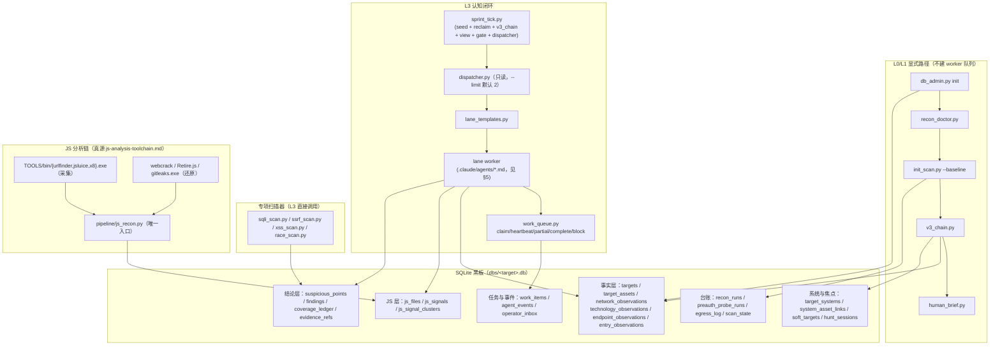

# 调用图谱（派生）

> **何时读这份**：改架构、找脚本之间的调用关系、判断某个能力属于哪一层时。
> **派生自代码**（`TOOLS/`、`migrations/`、`.agents/`）；与代码冲突时以代码为准。分层定义的真源是 `AGENTS.md` 的「v4.6 运行分层」，本文件只是它的调用关系视图。术语见 [`GLOSSARY.md`](GLOSSARY.md)。

## 1. 全景图



已归档、不在图内的旧链见 §6。

## 2. 两条主流程

**L0/L1（不建 worker 队列）**

```text
db_admin.py init --target --slug --domain      # 只登记委托根域，零网络请求
  → recon_doctor.py --target --db              # 本机 capability 检查，零网络
  → init_scan.py --target --db --baseline      # httpx 验活 + 技术指纹（enqueue_pages=False）
  → v3_chain.py --target --db                  # 系统聚类/评分、域名→IP→服务关联、入口与参数语义
  → human_brief.py --target --db --json        # compact 读模型
```

产出只进事实表（`target_assets`、`technology_observations`、`network_observations`、`system_type_observations`、`entry_observations`、`target_systems`、`recon_sources` / `recon_runs`），被动结果一律 `needs_review` / `intel_only`。

**L3（认知闭环）**

```text
human_brief 读焦点与 operator_actions
  → sprint_tick.py --target --db --json        # seed + reclaim + v3 chain facts + view + 候选门控
  → dispatcher.py --target --db [--limit N]    # 只读派发计划（默认 2；测试类并发子上限 2）
  → work_queue.py claim/heartbeat/partial/complete/block → agent_events.worker_result
  → 主 session 收割 → 假设 / unknown / coverage / decision_events 更新
```

## 3. 核心调用关系

| 调用方 | 被调方 | 机制 |
| --- | --- | --- |
| `db/sprint_tick.py` | `blackboard_seed.py` / `work_queue.py`(reclaim) / `v3_chain.py` / `blackboard_view.py` / `sprint_candidate_gate.py` / `dispatcher.py` | import |
| `db/dispatcher.py` | `lane_templates.py` / `generic_probe.py` / `system_contract.py` / `recon_readiness.py` | import |
| `db/lane_templates.py` | `.claude/agents/*.md` + src-hunter playbook + `mobile-api-attack-surface` skill | prompt 注入 |
| 主 session | `subagent(lane prompt)` → lane worker | DSH subagent |
| `pipeline/js_recon.py` | `TOOLS/bin/{urlfinder,jsluice,x8}.exe` + webcrack / Retire.js / `gitleaks.exe` + `utils/js_signal_store.py` | subprocess + import |
| `utils/js_signal_store.py` | `js_signals` / `js_signal_clusters`；`promote_js_candidates` 按分数晋级 `suspicious_points` | DB 写 |
| `pipeline/init_scan.py` | `target_assets` 验活回填；**非 `--baseline` 路径**才回填 `scan_state.seed_url` | DB 写 |
| `pipeline/{sqli,ssrf,xss,race}_scan.py` | `db/cookie_helper.py` / `db/db_utils.py`；读 `scan_state.seed_url`，为空直接退出 | import + DB 读 |
| `utils/egress.py` | 目标侧请求的唯一出口（`EGRESS_MODE` 默认 `yakit`） | 见 [`egress-traffic-shaping.md`](modules/egress-traffic-shaping.md) |

## 4. 数据表写入方

| 层 | 表 | 写入方 |
| --- | --- | --- |
| 事实 | `targets` / `target_assets` / `recon_sources` | `db_admin init` / `recon_intel` / `ownership_gate` |
| 事实 | `network_observations` / `technology_observations` / `cdn_observations` / `origin_candidates` | `init_scan` / `v3_chain` / `cdn_detect` |
| 事实 | `endpoint_observations` / `entry_observations` / `pages` | `entry_recursion` / `auth_explore` / `rebuild_target_db`（`pages` 为旧爬取链遗留，活跃代码只读） |
| JS | `js_files` / `js_signals` / `js_signal_clusters` | `js_recon` / `js_signal_store` / `auth_explore` / `wechat_api_analyzer` |
| 系统与焦点 | `target_systems` / `system_asset_links` / `soft_targets` / `soft_target_events` / `hunt_sessions` | `v3_chain` / `soft_target_scorer` / `focus_control` |
| 任务与事件 | `work_items` / `agent_events` / `operator_inbox` | `blackboard_seed` / `work_queue` / worker |
| 结论 | `suspicious_points` / `findings` / `coverage_ledger` / `evidence_refs` | 扫描器 / worker / `js_signal_store` 晋级 |
| 台账 | `recon_runs` / `preauth_probe_runs` / `egress_log` / `scan_state` | `recon_intel` / `recon_plan` / `init_scan` / `preauth_probe` / `egress` |

## 5. lane → worker 映射

真源：`TOOLS/db/lane_templates.py`（`LANE_TO_AGENT`）、`TOOLS/db/system_contract.py`（`COLLECTION_LANES`）、`TOOLS/db/dispatcher.py`（`LANE_DISPATCH`）。

| lane | worker 定义（`.claude/agents/`） | 无需 focus |
| --- | --- | --- |
| `asset_ingest` / `source_intel` | `asset-recon.md` | ✔ |
| `quick_scout` / `entry_explore` | `surface-scout.md` | ✔ |
| `entry_probe` | `entry-probe.md` | ✔ |
| `network_profile` / `origin_verify` | `stealth-scanner.md` | ✔ |
| `js_reverse` | `js-reversing-helper.md` | ✔ |
| `semantic_profile` | `attack-surface-profiler.md` | ✔ |
| `preauth_probe` | `preauth-probe.md` | ✘ |
| `replay` / `cognitive_experiment` | `surface-scout.md` | ✘ |
| `logic_probe` | `param-fuzzer.md` | ✘ |
| `hypothesis` | `hypothesis-drafter.md` | ✘ |
| `vuln_review` | `vuln-reviewer.md` | ✘ |
| `evidence_pack` | `src-reporter.md` | ✘ |
| `report_audit` | `vuln-auditor.md` | ✘ |
| `postexp` | `postexp-worker.md` | ✘（另需硬约束 5 的逐次批准） |
| `asset_triage` / `operator_task` | 无独立 agent 定义（主 session / 操作员决策） | — |

> **skill 归档 ≠ agent 定义失效**。`stealth-scanner`、`src-report`、`vuln-review`、`vuln-auditor` 这四个 **skill** 已归档到 `.agents/skills/.archived/`，但上表里同名的 **agent 定义**仍是这些 lane 的派发目标。归档的是知识包，不是 worker 身份。

## 6. 已淘汰（勿调用）

| 对象 | 位置 | 取代者 |
| --- | --- | --- |
| `run_scan.py`（旧 phase 状态机编排器） | `TOOLS/legacy/` | `sprint_tick` + `dispatcher` |
| `bfs_crawl.py` / `probe_runner.py` / `api_fuzz.py` / `brutescan.py` / `framework_exploit.py` / `upload_scan.py` / `reflect.py` / `reflect_map.py` / `entry_family_enumerator.py` | `TOOLS/legacy/` | 专项扫描器 + lane worker |
| `TOOLS/js_intel.py` / `js_analyzer.py` / `js_reverse_cli.py` / `runtime_trace_ingest.py` / `h5_asset_expander.py` | `TOOLS/legacy/js/`（2026-10-17 退役，连同 6 个旧测试文件；已保行为地修正路径锚点） | `pipeline/js_recon.py` + `utils/js_signal_store.py`；攻击面假设改走 `js_attack_surface.py` 库调用 |
| 7 个管线 skill（`stealth-scanner` / `vuln-review` / `src-report` / `vuln-auditor` / `business-logic-hunt` / `manual-replay` / `soft-target`） | `.agents/skills/.archived/` | 见 `docs/INDEX.md` §1 |

## 7. 边界提示

- 非 HTTP 端口、源站验证与 CIDR 受硬约束 8 约束（三件套 + 操作员批准）；**全端口扫描不属于 v4.6 入口**。`network_profile` lane 的 nmap adapter 只做有界服务/WAF 观察；`TOOLS/pipeline/full_port_scan.py` 无任何自动调用方，属手工工具。
- `scan_state` 不是 L0/L1 产物：`init_scan --baseline` 显式 `enqueue_pages=False` 且不写 `scan_state`；只有非 `--baseline` 的显式调用才回填 `scan_state.seed_url`，供 `sqli/ssrf/xss/race_scan` 取种子。
- 目标侧发包只经受管出口 `TOOLS/utils/egress.py`（硬约束 9）。
